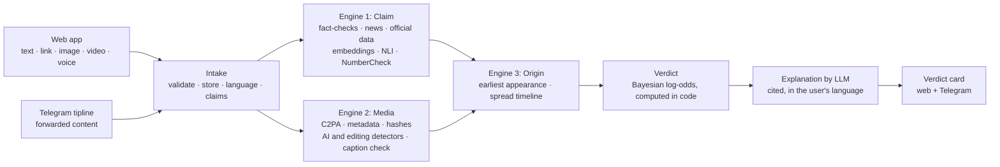

# Shinri AI 真理

**Check a forward before you share it.**
Shinri AI takes a suspicious claim, link, image, short video or voice note and returns a verdict with the evidence
behind it, how sure it is, and exactly which signals led there. Code computes the verdict. An LLM only reads and explains.

> Built for the Forge hackathon · Theme 1: Civic Pulse, Digital Governance & Public Information ·
> Problem #4: Real-Time Fact-Verification & Deepfake Audit Engine

---

## Contents
1. [The problem](#1-the-problem) · 2. [What Shinri AI does](#2-what-shinri-ai-does) · 3. [How it works](#3-how-it-works) ·
4. [Project status](#4-project-status-read-this-first) · 5. [The three engines](#5-the-three-engines) · 6. [The maths](#6-the-maths) ·
7. [Data sources](#7-data-sources) · 8. [AI stack](#8-ai-stack) · 9. [Shared contract and API](#9-shared-contract-and-api) ·
10. [Setup](#10-setup) · 11. [Repo layout](#11-repo-layout) · 12. [Team and parts](#12-team-and-parts) ·
13. [Demo script](#13-demo-script) · 14. [Limits](#14-limits-we-state-openly) · 15. [Free-tier plan](#15-the-0-plan)

## 1. The problem
In India, misinformation spreads mainly through WhatsApp forwards, Instagram reels and YouTube videos. A fact-check
arrives days later, if at all, and an ordinary person cannot tell a real claim from an old photo, an edited image or an
AI-generated clip. People need a quick, sourced, honest first check in their own language.

**Who it is for:** anyone who receives a suspicious forward, plus students, families, journalists and local officials.

## 2. What Shinri AI does
| You send | Shinri AI does | You see |
|---|---|---|
| Text or link | Extracts the factual claims, searches fact-checks, news and official sources, compares the evidence, recalculates numbers from official data | Verdict, reasons, sources, number comparison, confidence, time checked |
| Image | Reads metadata and Content Credentials, hashes the image, looks for an earlier copy, runs weak AI and editing detectors, compares caption to image | Signals with strengths and limits, earliest known appearance |
| Video | Pulls audio and a few frames, transcribes speech, checks the claims, analyses frames | Transcript, claims checked, evidence, cautious overall report |
| Voice note | Transcribes (Hindi, Telugu and more), translates if needed, checks the claims, optional fake-voice signal | Transcript, verdicts, sources |

**Verdict labels:** `supported` · `contradicted` · `old_or_out_of_context` · `signs_of_editing` · `possible_ai_generated` · `not_enough_evidence`.
A detector alone never produces a definite "fake". When evidence is thin, the answer is "not enough evidence", never a guess.

**What makes it different**
* **NumberCheck:** a claim with a number is recomputed from official data, not just compared with text.
* **Origin tracing:** finds where a photo or claim first appeared ("this 'flood today' video is from 2019").
* **Explainable confidence:** a Bayesian score where every signal's contribution is shown. The AI never decides alone.
* **India-first:** Indian-language voice and text through Whisper and IndicTrans2.
* **Honest by design:** every card shows its sources, its limits and the time it was checked.

## 3. How it works

Claim and media run in parallel. Origin runs next and sees the extracted claims. The verdict step combines every signal.
The LLM extracts claims and writes the explanation. It never sets the verdict or the confidence.

## 4. Project status (read this first)
This table is the honest state of the repo. It is updated as parts land.

| Part | What | Status |
|---|---|---|
| **Part 1: Platform and interfaces** | FastAPI service, SQLite, web app (light and dark), Telegram tipline, file validation, retries and failure handling, pipeline, reference fusion, 30 tests | **Built and tested** (Telegram tested against a simulated API; confirm with a real bot token) |
| **Part 2: Claim and evidence intelligence** | LLM router, claim extraction, retrieval, embeddings, NLI, NumberCheck, verdict engine, cited multilingual explanation | **In progress.** `shinri/engines/claim.py` and `verdict.py` are placeholders |
| **Part 3: Media forensics and origin** | C2PA and metadata, ELA, perceptual-hash index, AI-image and fake-voice detectors, caption check, video frames, Wayback and timeline | **In progress.** `shinri/engines/media.py` and `origin.py` are placeholders |
| Live trend monitors (YouTube, Reddit, GDELT) | Spiking-claim detection | Stretch goal, not enabled |
| WhatsApp tipline | Cloud API intake | Stretch goal, not enabled |

While an engine is a placeholder, its results are labelled "placeholder" in the UI and Telegram, and the verdict is
"not enough evidence". Nothing in the interface is hardcoded or faked.

## 5. The three engines
**Engine 1, Claim and evidence.** Extract atomic claims with the exact quote, entities, dates and numbers. Search
existing fact-checks, news and official sources. Match claims to known fact-checks by multilingual embedding similarity.
Judge support or contradiction with an NLI model (translating first if the language is not covered). NumberCheck pulls
the number, unit and period from the claim, recomputes it from official data and reports the relative error.

**Engine 2, Media forensics.** File and metadata inspection, Content Credentials (C2PA), perceptual hashes against our
own index, Error Level Analysis, two AI-image detectors and one fake-voice detector as weak signals, CLIP caption-image
comparison, and sampled video frames and audio. Each finding is a separate signal with its method and its limit.
Missing metadata is not proof of manipulation.

**Engine 3, Origin and spread.** Wayback Machine for earlier copies of a link, our own perceptual-hash index for
visually similar images, and YouTube, Reddit and GDELT where keys and quotas allow. Results are "earliest *known*
appearance", never "the original". Burst detection runs only when there is enough timestamped data.

## 6. The maths
**Verdict (Bayesian log-odds fusion).** Each signal has a strength *s* in [−1, +1] and a fixed weight *w*:

$$\log\frac{P(\text{true}\mid E)}{P(\text{false}\mid E)}=\log\frac{P(\text{true})}{P(\text{false})}+\sum_i w_i\,s_i$$

Negative strength is evidence against the claim or against authenticity. Signals that cite the same source are counted
once. If the result is within ±0.75 of neutral, or there are no signals, the label is `not_enough_evidence`.
The confidence shown is the logistic probability of that log-odds, and it is **not** a calibrated real-world probability
until it has been evaluated on labelled examples.

**Same claim?** Cosine similarity of multilingual embeddings: $\cos(a,b)=\dfrac{a\cdot b}{\lVert a\rVert\,\lVert b\rVert}$, above a threshold tuned on examples.

**Supported or contradicted?** From the NLI model: $s = P(\text{entailment}) - P(\text{contradiction})$.

**Same image?** 64-bit perceptual hashes compared by Hamming distance. A small distance means the same picture after
resizing or recompression.

**Going viral now?** Hourly mentions $x_t$ against the claim's own baseline: $z_t=\dfrac{x_t-\bar{x}}{s}$. A burst is $z>3$.

**NumberCheck.** $\text{relative error}=\dfrac{|\text{claimed}-\text{official}|}{\text{official}}$. Above a set tolerance
(for example 10%) the claim is flagged as numerically wrong, with both figures and the source.

## 7. Data sources
All inputs are live or official, and free.

| Source | Use | Status |
|---|---|---|
| Telegram Bot API | Tipline | Free |
| WhatsApp Cloud API | Tipline (stretch) | Free service replies within Meta's monthly allowance; verify current terms |
| Instagram | Only as forwarded content (screenshot, caption, reel) | Live hashtag search needs App Review and business verification, so it is not used |
| YouTube Data API v3 | Trending and claim tracing | Free key, 10,000 units/day |
| Reddit API | India subreddits | Free OAuth app; approval may be required |
| GDELT DOC API | News coverage and timelines | No key; one request per 5 s |
| Google Fact Check Tools API | Published fact-checks | Free key; confirm quota |
| Wayback Machine availability API | Earliest archived copy | No key |
| Data.gov.in and PIB | NumberCheck | Free key for Data.gov.in |
| X (Twitter), Bluesky | Not used | X API is paid; Bluesky public search was blocked in our test |

## 8. AI stack
**LLM router** (code tries in order and falls back on error or rate limit): Groq → Gemini free tier → local Ollama →
no-AI keyword and template fallback (marked "needs review"). Hugging Face's hosted inference gives free accounts no
credits, so open models run on our own machine or a free Space.

**Open models** (licences checked on the Hugging Face Hub, 31 Oct 2026):

| Job | Model | Licence |
|---|---|---|
| Speech to text | [openai/whisper-large-v3-turbo](https://huggingface.co/openai/whisper-large-v3-turbo) | MIT |
| English → Indian languages | [ai4bharat/indictrans2-en-indic-dist-200M](https://huggingface.co/ai4bharat/indictrans2-en-indic-dist-200M) | MIT |
| Indian languages → English | [ai4bharat/indictrans2-indic-en-dist-200M](https://huggingface.co/ai4bharat/indictrans2-indic-en-dist-200M) | MIT |
| Same claim? (embeddings) | [intfloat/multilingual-e5-small](https://huggingface.co/intfloat/multilingual-e5-small) | MIT |
| Supported or contradicted? (NLI) | [MoritzLaurer/mDeBERTa-v3-base-xnli-multilingual-nli-2mil7](https://huggingface.co/MoritzLaurer/mDeBERTa-v3-base-xnli-multilingual-nli-2mil7) | MIT |
| Caption matches image? | [sentence-transformers/clip-ViT-B-32-multilingual-v1](https://huggingface.co/sentence-transformers/clip-ViT-B-32-multilingual-v1) | Apache-2.0 |
| Language ID | [facebook/fasttext-language-identification](https://huggingface.co/facebook/fasttext-language-identification) | CC-BY-NC-4.0 (non-commercial) |
| AI image (weak signal) | [buildborderless/CommunityForensics-DeepfakeDet-ViT](https://huggingface.co/buildborderless/CommunityForensics-DeepfakeDet-ViT) | MIT |
| AI image, second opinion | [Ateeqq/ai-vs-human-image-detector](https://huggingface.co/Ateeqq/ai-vs-human-image-detector) | Apache-2.0 |
| Fake voice (weak signal) | [MelodyMachine/Deepfake-audio-detection-V2](https://huggingface.co/MelodyMachine/Deepfake-audio-detection-V2) | Apache-2.0 |

Non-ML tools: `c2pa`, `exiftool` and Pillow for metadata, `imagehash` for perceptual hashes, Tesseract or Gemini for OCR, FFmpeg for frames and audio.
Detectors trained on older generators often miss newer ones, so each is tested on our own real and fake samples and used as a weak signal only.
Disk size: about 8 GB for every model, about 4 GB if Whisper runs on Groq and language ID uses a small library.

## 9. Shared contract and API
One record per check, shared by all parts (full field list and examples in [`docs/ENGINE_CONTRACT.md`](docs/ENGINE_CONTRACT.md)):

```json
{
  "checkId": "chk_ab12cd34ef", "receivedAt": "2026-11-01T09:30:00Z", "channel": "telegram",
  "input": {"type": "image", "text": "caption", "mediaRef": "…", "language": "te"},
  "claims": [{"id": "c1", "text": "claim as extracted", "quote": "exact words", "numbers": []}],
  "signals": [{"engine": "origin", "kind": "earlier_copy", "strength": -0.9, "weight": 2.0,
               "summary": "…", "evidence": {"url": "https://…"}}],
  "verdict": {"label": "old_or_out_of_context", "confidence": 0.91, "topReasons": ["…"]},
  "explanation": {"language": "te", "text": "…", "citations": ["https://…"]},
  "status": "done"
}
```
| Endpoint | Owner | Purpose |
|---|---|---|
| `POST /checks` | Part 1 | Accept text, link or a file; returns `checkId` |
| `GET /checks/{id}` · `GET /checks` | Part 1 | One record · recent history |
| `GET /media/{id}` · `GET /trending` · `GET /health` | Part 1 | Stored media · claims checked more than once today · status |
| `POST /engines/claim` | Part 2 | Claims and claim signals |
| `POST /engines/verdict` | Part 2 | Fusion and cited explanation |
| `POST /engines/media` | Part 3 | Media signals |
| `POST /engines/origin` | Part 3 | Earliest appearance and timeline |

## 10. Setup
**You need:** Python 3.11 or newer, and Git. A modern browser. No GPU.

### 1. Get the code
```bash
git clone https://github.com/<owner>/<repo>.git
cd <repo>
```

### 2. Install
```bash
python -m venv .venv
source .venv/bin/activate          # Windows PowerShell: .venv\Scripts\Activate.ps1
pip install -r requirements-dev.txt
```

### 3. Check it works
```bash
python -m pytest -q                # expect: 30 passed
```

### 4. Start the app
```bash
uvicorn app:app --port 7860
```
Open http://localhost:7860. Until the Part 2 and Part 3 engines are added you will see "Demo mode" and "Not enough evidence".
That is expected.

### 5. Telegram tipline (optional)
1. In Telegram, message **@BotFather**, send `/newbot`, and copy the token it gives you.
2. Copy `.env.example` to `.env` and paste the token after `TELEGRAM_BOT_TOKEN=`, **or** set it when you start:
   * Mac/Linux: `TELEGRAM_BOT_TOKEN=<token> uvicorn app:app --port 7860`
   * Windows PowerShell: `$env:TELEGRAM_BOT_TOKEN="<token>"; uvicorn app:app --port 7860`
3. Send your bot a message. It replies with a receipt, then a verdict card.

Never commit a real token. `.env` is already in `.gitignore`.

### 6. Add your engines (Part 2 and Part 3)
Edit the files in `shinri/engines/` (`claim.py`, `verdict.py`, `media.py`, `origin.py`) following
[`docs/ENGINE_CONTRACT.md`](docs/ENGINE_CONTRACT.md). To host an engine elsewhere, set its URL in `.env`, for example
`ENGINE_CLAIM_URL=https://example.com/engines/claim`.

### 7. API keys for the engines
Put these in `.env` when you build the engines that use them. Quotas and terms change, so check each when you create the key.

| Key | Where to get it | Used by |
|---|---|---|
| `GROQ_API_KEY` | console.groq.com | LLM router, hosted Whisper |
| `GEMINI_API_KEY` | aistudio.google.com | Images, video, LLM fallback |
| `YOUTUBE_API_KEY` | Google Cloud Console, YouTube Data API v3 | Origin, trending |
| `FACTCHECK_API_KEY` | Google Cloud Console, Fact Check Tools API | Claim engine |
| `DATA_GOV_IN_API_KEY` | data.gov.in | NumberCheck |
| Reddit app id and secret | reddit.com/prefs/apps | Origin (register early; approval may be needed) |

### 8. Deploy on a free Hugging Face Space
1. Create a new Space, choose **Docker**.
2. Push this repo to it. It listens on port 7860.
3. Add your keys under the Space's **Settings → Variables and secrets**.

The free tier sleeps when idle and its disk is not permanent, so history resets on restart. Keep a local copy running for the live demo.

### Troubleshooting
| Problem | Fix |
|---|---|
| `uvicorn: command not found` | Activate the virtual environment, or run `python -m uvicorn app:app --port 7860` |
| Port 7860 already in use | Use another port: `--port 7861` |
| Telegram bot does not reply | Check the token, and that only one copy of the app is running (a bot token can be polled by one process) |
| Uploads rejected | Images up to 10 MB, video and audio up to 20 MB; JPG, PNG, WebP, GIF, MP4, MOV, WebM, OGG, MP3, WAV, M4A |
| History is empty after restart | Expected on a free Space; locally it is kept in `data/shinri.db` |

## 11. Repo layout
```
app.py                     entry point
shinri/api.py              routes, rate limit, engine mounting
shinri/orchestrator.py     the pipeline: claim + media → origin → verdict
shinri/engine_client.py    timeouts, retries, failure handling
shinri/service.py          validate, store and start a check (web and Telegram share it)
shinri/validation.py       file-type sniffing and size limits
shinri/fusion.py           reference Bayesian fusion (used until Part 2's verdict engine lands)
shinri/telegram_bot.py     tipline
shinri/engines/            Part 2 and Part 3 replace these four files
shinri/static/             web UI: plain HTML, CSS, JS (mustard gold, light and dark)
docs/ENGINE_CONTRACT.md    what each engine receives and returns
tests/                     30 tests
```

## 12. Team and parts
The work splits into three parts that meet at the shared record.

| | Part 1: Platform and interfaces | Part 2: Claim and evidence | Part 3: Media and origin |
|---|---|---|---|
| Owns | API, database, web app, Telegram, deployment | LLM router, claims, retrieval, NLI, NumberCheck, verdict, explanation | C2PA, ELA, hash index, detectors, video frames, Wayback, timeline |
| Owner | _add name_ | _add name_ | _add name_ |

## 13. Demo script
1. **Live claim:** forward a claim trending today to the Telegram bot; show the verdict and its sources.
2. **NumberCheck:** forward a message with a wrong statistic; show the recomputation from official data.
3. **Old photo, new story:** an old disaster photo captioned as "today" is traced to its earlier appearance.
4. **AI image:** forward a freshly generated image; show "possible AI-generated" with its limits.
5. **Voice note in Telugu or Hindi:** transcribed, checked, answered.
6. **Failure case:** disable one provider mid-demo; the router falls back and the check still completes.

## 14. Limits we state openly
* AI-image and deepfake detectors are unreliable on new generators; they are weak signals, never proof.
* Instagram and WhatsApp cannot be monitored; their content reaches us when people forward it.
* No free web-wide reverse-image search exists; image matching uses our own index plus archives.
* Free tiers have rate limits, so results are cached and queued.
* The confidence number is not a calibrated probability until tested on labelled data.
* Shinri AI supports your judgement; it does not replace it. If you were scammed, call 1930 or visit cybercrime.gov.in.

## 15. The ₹0 plan
Free tiers and open models only: Groq and Gemini free tiers for language work, open Hugging Face models run locally or on
a free Space, free keys for YouTube, Reddit, Data.gov.in and Telegram. Free quotas, card requirements and terms change,
so verify each when you create its key.

## Licence
MIT. See [LICENSE](LICENSE). The `fastText` language-ID model is non-commercial; swap it before any commercial use.
